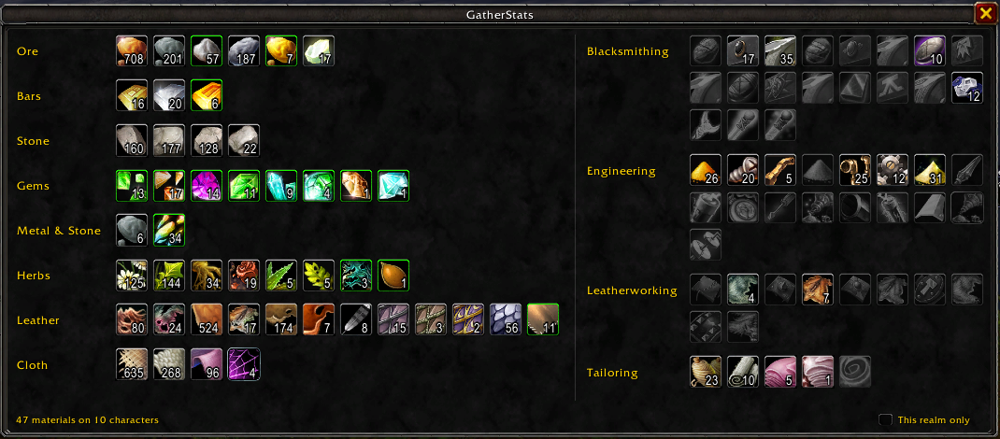

# GatherStats

GatherStats är ett World of Warcraft-tillägg som samlar en översikt över dina karaktärers material i ett enda fönster. Uppgifterna hämtas från **Syndicator** och omfattar väskor, bank och post.

## Funktioner

- Visar totalantal för malm, metalltackor, sten, ädelstenar, örter, läder, tyg och elementära material.
- Visar fördelningen per karaktär och förvaringsplats när du håller muspekaren över ett föremål.
- Har en separat panel för utvalda tillverkade föremål inom Blacksmithing, Engineering, Leatherworking och Tailoring.
- Visar receptens materialbehov och hur många tillverkningar de samlade materialen räcker till.
- Kan filtrera översikten till aktuell realm.
- Uppdateras automatiskt när Syndicator rapporterar ändringar i väskor eller post.

## Installation

1. Installera och aktivera **Syndicator**, som är ett obligatoriskt beroende.
2. Placera mappen `GatherStats` i spelklientens `Interface/AddOns/` så att filen ligger på `Interface/AddOns/GatherStats/GatherStats.toc`.
3. Starta om spelet om det kördes under installationen och aktivera GatherStats i tilläggslistan.
4. Logga in på de karaktärer du vill inkludera. Öppna deras bank och brevlåda så att Syndicator kan uppdatera underlaget.

## Användning

Skriv `/gather` eller `/gs` i chatten för att öppna eller stänga fönstret.

## Exempel
